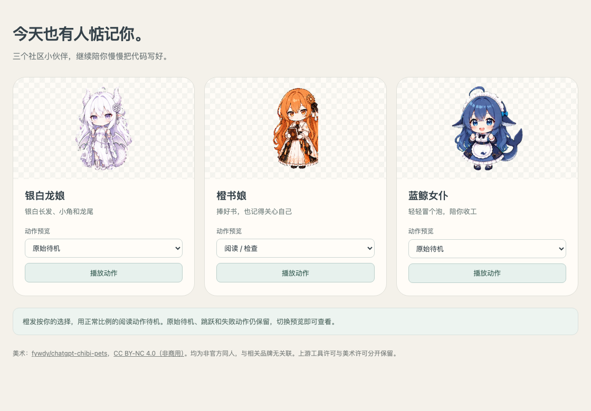
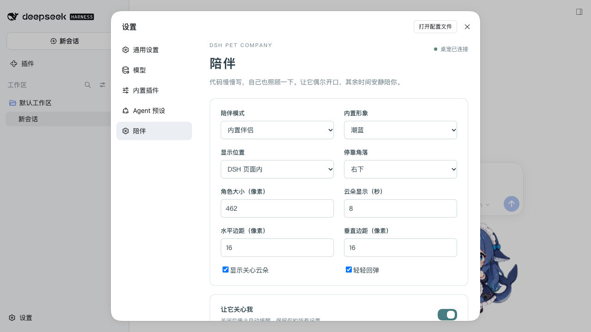
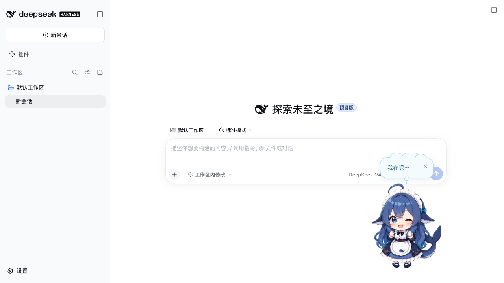

# dsh-pet-company

安静一点的桌面陪伴：坐久了起来走走，水杯空了续一下，深夜了早点收工。三套随包 Q 版角色，默认安静，其余时间陪你慢慢写代码。

English: a calm desktop companion plugin for DeepSeek Harness. It ships three chibi characters and quiet break / water / long-session / late-night reminders, with cloud bubbles and a light bounce. Source code is MIT; the bundled character art is CC BY-NC 4.0 (attribution, non-commercial). Verified with DSH 0.2.0-rc.2 / DSH Desktop 2.0.17 on macOS arm64; Windows and Linux are untested.



## 截图





## 它会做什么

- 久坐、喝水、连续工作和深夜关怀四类提醒，可分别关闭；默认安静档每小时最多一句。
- 审批或提问等待期间保持安静；断线、目标切换和冷却期不积压、不补发关怀。
- 新装默认内置模式，只显示一只银白；银白、橙书娘、蓝鲸女仆可随时切换。
- 内置模式随包提供三套透明动画、云朵气泡、等比轻回弹和派生播放器，不再需要手工替换原版 dsh-pet 文件。
- 可选外部模式：同一 Profile 已安装并启用原版 dsh-pet 时，只向它发送基础关怀，不接管其窗口、配置或资源。
- 「设置 → 陪伴」管理模式、角色、显示位置、外观、提醒频率与静默时段；「试说一句」会真实显示一条关怀。

本插件不调用模型、不读取键盘输入，也不采集健康数据。桌面窗口是独立命名、独立数据目录的 Electron helper；缺少运行时时设置仍可用，只有明确点击并同意后才会下载。

## 安装

当前版本 **0.2.0**，适配 DSH 0.2.0-rc.x（实测 0.2.0-rc.2 / DSH Desktop 2.0.17），Node.js 22.13+。

**方式一：dshmarket（推荐）**

打开 DSH Desktop → 设置 → 插件市场（dshmarket），搜索 `dsh-pet-company`，点击安装并按提示重启当前 Profile。目录收录正在审核，合并后市场会自动同步；如果暂时搜不到，使用方式二。

**方式二：GitHub Release**

Web profile 或自定义 profile 可直接安装预构建 tarball：

```sh
dsh plugin --profile <你的 Profile> add https://github.com/Oliveryfaso/dsh-pet-company/releases/download/v0.2.0/dsh-pet-company-0.2.0.tgz
dsh --profile <你的 Profile>
```

Desktop 用户在应用自己的「设置 → 插件」入口填写同一个 tarball 地址；普通 npm CLI 不能管理 Desktop 保留的 `desktop` Profile。完整步骤、升级、卸载与回退见 [安装说明](docs/INSTALL.md)。

**显示位置**

- **DSH 页面内**：角色显示在 DSH 页面右下角，不需要独立 Electron；本项目目前在 macOS 上实测，其他平台未验证。
- **桌面窗口**：独立透明置顶窗口，需要 macOS arm64 和官方 Electron 43.3.0；首次在设置里点击下载并确认。
- **暂不显示**：保留提醒调度和全部设置。

新装默认「桌面窗口」。没有独立运行时不会自动下载，设置页会说明原因，其他设置仍可修改保存。

## 第一次使用

1. 重启 Profile 后打开「设置 → 陪伴」，确认状态为「桌宠已连接」。
2. 选择「内置形象」与「显示位置」。想跳过 Electron 下载时，先选「DSH 页面内」并保存。
3. 点击宠物可看到云朵气泡；「试说一句」会发送一条真实关怀（每分钟最多一次）。
4. 外部模式需要先在同一个 Profile 安装并启用 [dsh-pet](https://github.com/PC2005-cloud/dsh-pet)，再把「陪伴模式」切换为外部。

| 角色 | 内置 ID | 默认待机 |
|---|---|---|
| 银白龙娘 | `companion-silver` | 源 idle |
| 橙书娘 | `companion-orange` | 源 review，1030 ms 循环 |
| 蓝鲸女仆 | `companion-tide` | 源 idle |

橙色角色的点击与关怀使用正常比例的阅读动作，原偏扁动作只保留在来源预览，不再由自动路径触发。

## 设置说明

- **提醒**：总开关「让它关心我」；四类提醒各自开关与间隔/开始时间；安静/刚刚好/多聊一点三档频率；静默时段；「安静一小时」。
- **外观**：内置形象、显示位置、停靠角落、角色大小（100–800 px）、水平/垂直边距、云朵显示时长（3–20 秒）、显示云朵、轻轻回弹。
- **外部模式**：仅当已经安装 dsh-pet 时需要；填写目标宠物 ID（默认 `main`）。切换模式不会修改 dsh-pet 的配置。
- 设置写入 `$DSH_HOME/dsh-pet-company/config.v2.json`。旧版 `config.json` 与 `dsh-companion/config.json` 只在新文件不存在时只读迁移；新文件损坏时停止关怀并提示修复，不覆盖原文件。
- 同一 DSH home 同时只允许一个运行拥有者；其他 Profile 只读显示占用，不调度、不保存。

## 更新、停用与卸载

- **更新**：市场内一键更新，或重新安装更新版本的 tarball，然后重启 Profile。只改源码目录不代表已加载。
- **暂时关闭**：使用「安静一小时」；长期停止自动提醒可关闭总开关。把「显示位置」设为「暂不显示」可隐藏角色但保留设置。
- **卸载**：使用安装时的同一入口移除 `dsh-pet-company`。卸载默认保留设置与运行时缓存，也不会卸载 dsh-pet。若装过旧包 `dsh-companion`，需单独移除，避免两个提醒器并行。
- **回退**：先停用当前版本并确认 helper 退出，再安装较早的 release；旧版只读取旧配置文件，v2 设置保留不写回。

## 兼容范围

| 环境 | 状态 |
|---|---|
| DSH 0.2.0-rc.2 Web profile（macOS） | 已验证：安装、设置、页面内三角色、点击/试说云朵、保存与重启、卸载与清理 |
| DSH Desktop 2.0.17 主窗口（macOS） | 基础流程已验证；完整桌面 helper 透明/焦点/点击穿透/多屏仍待补充 |
| 独立 Electron 桌面窗口 | 仅 macOS arm64 / Electron 43.3.0；首次下载路径未做真实网络完整验收 |
| Windows / Linux / Web 移动端 | 未验证，不宣称可用 |

详细记录与未验项见 [兼容性](docs/COMPATIBILITY.md)。

## 已知限制

- 透明浮窗的跨应用焦点、点击穿透、拖拽、物理多屏/DPR 仍需更多实机验收。
- 独立 Electron 的下载、缓存和中断恢复未做完整网络验收；只支持官方 43.3.0 / macOS arm64。
- 源素材约 6 个逻辑帧/秒，动作本身仍有分帧感。
- 外部模式的外观取决于原版 dsh-pet；云朵与轻回弹只在内部组件提供。
- dshmarket 目录收录与市场内一键安装尚待官方目录合并后确认。
- 375px 窄窗口下 DSH 设置弹窗会被宿主侧栏压缩，未宣称手机可用。

## 开发检查

```sh
npm test
npm run check
npm pack --dry-run --ignore-scripts --offline
```

Node.js 22.13+；核心回归无需安装 npm 依赖。`npm run build` 使用 Node 内置类型擦除生成派生 reducer 和 helper/client bundle。包内交付预构建 JavaScript 与视频，无 prepare/postinstall、无 Electron 二进制、无安装时依赖补丁。CI 不启动 DSH，也不等同于真实宿主验收。

## 许可与来源

- 插件自有代码、测试和构建脚本：[MIT](CODE-LICENSE.md)。
- 派生播放器与工作状态 reducer 来自 PC2005-cloud/dsh-pet 0.3.7，保留 [上游 MIT 版权与许可](vendor/dsh-pet-0.3.7/LICENSE)。
- 三套角色美术来自 [fywdy/chatgpt-chibi-pets](https://github.com/fywdy/chatgpt-chibi-pets)，为非官方同人，采用 **CC BY-NC 4.0：署名、非商业性使用**。该限制覆盖派生的透明视频、预览与截图；含素材的完整发布包不能按纯 MIT 使用。
- 本项目以免费、非商业方式在 GitHub 与 DSH 插件目录分发；如用于收费产品、付费分发或其他商业用途，须另行取得美术权利方授权或替换素材。
- 角色不是任何品牌的官方形象，也未获得品牌授权或背书。

完整范围见 [LICENSE](LICENSE)、[美术许可](ASSET-LICENSE.md)、[第三方说明](THIRD_PARTY_NOTICES.md)、[更新日志](CHANGELOG.md) 与 [上游资料](assets/upstream/README.md)。
